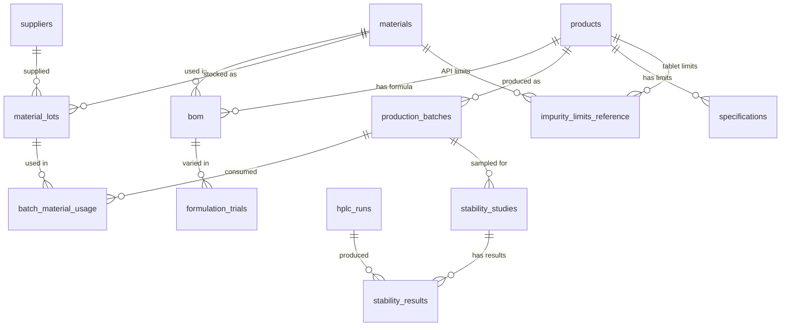

# PharmaPilot

**فريق SaMo · مسابقة RoboCraft 2.0.0 · المسار الأول: الصيدلة والدواء**

PharmaPilot هو **وكيل ذكاء اصطناعي (AI Agent)** لمصانع الأدوية الأردنية. بيعمل ثلاث شغلات:
1. **بيراقب دراسات الثبات:** بيكتشف النتائج الخارجة عن المواصفات (OOS) أو اللي بلّشت تنحرف (OOT)، وبيبعت تنبيه بعد موافقة مشرف الجودة.
2. **بيجهّز دفعات الإنتاج:** بيربط وصفة الدواء بالمخزن، بيختار المواد حسب قاعدة "الأقرب انتهاءً أولاً" (FEFO)، وبيطلع النقص وطلب الشراء.
3. **بيجمع الأدلة قبل تعديل نسب المكونات:** من الحدود الرسمية والتجارب السابقة.

هاد الريبو فيه **قاعدة البيانات المصطنعة الكاملة** اللي رح نبني عليها الوكيل، مع الكود اللي ولّدها، والاختبارات، وشرح كامل. المقترح المسلَّم للمرحلة الأولى موجود بـ[`docs/`](docs/).

> ⚠️ **كل البيانات هون مصطنعة (synthetic).** ما في ولا سجل حقيقي من أي شركة، وما في أي بيانات شخصية. هاد شرط من شروط المسابقة.

---

## المحتويات

1. [بسرعة: شو لازم أعرف؟](#1-بسرعة-شو-لازم-أعرف)
2. [ترتيب الملفات بالريبو](#2-ترتيب-الملفات-بالريبو)
3. [كيف أشغّل الشغل على جهازي](#3-كيف-أشغل-الشغل-على-جهازي)
4. [القصة: كيف بيشتغل مصنع الأدوية، وليش كل جدول](#4-القصة-كيف-بيشتغل-مصنع-الأدوية-وليش-كل-جدول)
5. [الجداول الـ13 باختصار](#5-الجداول-الـ13-باختصار)
6. [كيف الجداول مربوطة ببعض](#6-كيف-الجداول-مربوطة-ببعض)
7. [كيف انولّدت البيانات خطوة بخطوة](#7-كيف-انولدت-البيانات-خطوة-بخطوة)
8. [الحالات المقصودة اللي لازم الوكيل يكتشفها](#8-الحالات-المقصودة-اللي-لازم-الوكيل-يكتشفها)
9. [كيف الوكيل رح يستخدم كل جدول](#9-كيف-الوكيل-رح-يستخدم-كل-جدول)
10. [الاختبارات الستة: شو بتفحص](#10-الاختبارات-الستة-شو-بتفحص)
11. [أمثلة استعلامات SQL](#11-أمثلة-استعلامات-sql)
12. [قواعد الشغل للتيم](#12-قواعد-الشغل-للتيم)
13. [حدود البيانات (لازم نكون صريحين فيها)](#13-حدود-البيانات-لازم-نكون-صريحين-فيها)
14. [قاموس المصطلحات](#14-قاموس-المصطلحات)
15. [أسئلة متكررة](#15-أسئلة-متكررة)

---

## 1) بسرعة: شو لازم أعرف؟

| الشي | القيمة |
|---|---|
| عدد الجداول | **13** |
| مجموع السجلات | **65,742** |
| أكبر جدول | `stability_results`: 31,080 نتيجة ثبات |
| الصيغة | قاعدة **SQLite** (ملف واحد `data/pharmapilot.db`) + نسخة **CSV** لكل جدول بـ`data/csv/` |
| تاريخ "اليوم" بالبيانات | **2026-11-25** (كل "منتهي" أو "قريب ينتهي" محسوب على هالتاريخ) |
| المنتج الأساسي بالعرض | **Montelukast 10mg** (`product_id = 1`)، ومادته الفعالة `material_id = 1` |
| مكتبات Python المطلوبة | **ولا وحدة.** كله بمكتبات Python الأساسية (standard library) |
| نسخة Python | 3.13 أو أحدث |
| الاختبارات | 6 اختبارات، وكلها ناجحة |
| الـseed | `42` (نفس الرقم بيطلع نفس البيانات بالضبط كل مرة) |

**ليش Montelukast؟** لأنه الشركة اللي قابلناها زودتنا بمواصفاته الرسمية (Ph. Eur. 2583 للمادة الخام، و BP للأقراص) وبقالب طريقة التحليل (MOA) اللي بيستخدموه. فبنينا البيانات عليه عشان تكون قريبة من الواقع.

---

## 2) ترتيب الملفات بالريبو

```
PharmaPilot/
├── README.md                  ← هاد الملف: الشرح الكامل
├── .gitignore
├── data/
│   ├── pharmapilot.db         ← قاعدة البيانات (SQLite) بكل الجداول الـ13
│   └── csv/                   ← نفس الجداول، كل جدول بملف CSV (بينفتح بـExcel)
│       ├── products.csv
│       ├── materials.csv
│       ├── suppliers.csv
│       ├── bom.csv
│       ├── material_lots.csv
│       ├── production_batches.csv
│       ├── batch_material_usage.csv
│       ├── specifications.csv
│       ├── stability_studies.csv
│       ├── stability_results.csv
│       ├── hplc_runs.csv
│       ├── formulation_trials.csv
│       └── impurity_limits_reference.csv
├── generator/
│   └── generate_db.py         ← الكود اللي ولّد كل البيانات
├── tests/
│   └── test_db.py             ← 6 اختبارات بتتأكد إنه البيانات سليمة
└── docs/
    ├── DATA_DICTIONARY.md     ← شرح كل عمود بكل جدول (بالتفصيل)
    ├── example_queries.sql    ← 12 استعلام SQL جاهز ومجرّب
    └── SaMo - الصيدلة والدواء.pdf  ← مقترح المرحلة الأولى
```

**الفرق بين `pharmapilot.db` و`csv/`:** نفس البيانات بالضبط. الـ`.db` أسرع وبيدعم الاستعلامات (SQL) والربط بين الجداول، وهو اللي الوكيل رح يستخدمه. الـCSV أسهل لو بدك تفتح جدول بـExcel وتتفرج عليه.

---

## 3) كيف أشغّل الشغل على جهازي

### أ) نزّل الريبو
```bash
git clone https://github.com/Mohdsuhail06/PharmaPilot.git
cd PharmaPilot
```

### ب) شغّل الاختبارات (تأكد إنه كل شي سليم)
```bash
python tests/test_db.py
```
لازم يطلع آخر شي `OK` و`Ran 6 tests`. (أول مرة بياخذ كم ثانية لأنه بيعيد توليد البيانات وبيقارنها.)

### ج) تفرّج على البيانات
**الطريقة الأسهل:** نزّل برنامج [DB Browser for SQLite](https://sqlitebrowser.org/) (مجاني)، وافتح فيه `data/pharmapilot.db`. بتشوف كل الجداول وبتقدر تكتب SQL بتبويب "Execute SQL".

**أو بـExcel:** افتح أي ملف من `data/csv/`.

**أو بـPython:**
```python
import sqlite3

conn = sqlite3.connect("data/pharmapilot.db")
rows = conn.execute("SELECT * FROM products LIMIT 5").fetchall()
for row in rows:
    print(row)
```

### د) أعد توليد البيانات (لو احتجت)
```bash
python generator/generate_db.py --seed 42 --output-dir data
```
- `--seed 42`: نفس الرقم = نفس البيانات بالضبط. رقم ثاني = بيانات مختلفة بنفس الشكل والقواعد.
- `--output-dir`: وين تنحفظ. لو بدك نسخة تجريبية بدون ما تمسح الأصلية: `--output-dir data_test`.

---

## 4) القصة: كيف بيشتغل مصنع الأدوية، وليش كل جدول

عشان تفهم الجداول، لازم تفهم مسار الدواء جوّا المصنع. هاي القصة بالترتيب:

1. **المصنع عنده منتجات** (أدوية): مثلاً Montelukast 10mg. ← جدول `products`.
2. **كل منتج إله "وصفة"**: شو بيدخل بالحبة الوحدة وبأي كمية (مادة فعالة + مواد مساعدة). ← جدول `bom`.
3. **المواد بتيجي من موردين** ← جدول `suppliers`، **وكل مادة إلها معلومات أساسية** (وحدتها، حد إعادة الطلب، مدة التوريد) ← جدول `materials`.
4. **المواد بتوصل المستودع على شكل "دفعات" (lots)**: كل دفعة إلها كمية وتاريخ انتهاء وحالة (معتمدة، بالحجر، مرفوضة، منتهية). ← جدول `material_lots`.
5. **المصنع بينتج "دفعات إنتاج" (batches)**: مثلاً 200,000 حبة Montelukast بتاريخ معين. ← جدول `production_batches`.
6. **كل دفعة إنتاج بتستهلك دفعات مواد معينة**، ولازم نسجّل مين دفعة مادة دخلت وين (التتبع). ← جدول `batch_material_usage`.
7. **كل منتج إله مواصفات**: حدود مقبولة لكل فحص (المحتوى، الذوبان، الشوائب...). ← جدول `specifications`.
8. **بعد الإنتاج، بنعمل "دراسة ثبات"**: بناخذ عينات من الدفعة وبنخزنها بظرف حرارة ورطوبة، وبنفحصها على فترات (0، 3، 6، 12، ... 36 شهر). ← جدول `stability_studies`.
9. **نتيجة كل فحص بكل نقطة زمنية بتنسجل** ← جدول `stability_results`.
10. **أغلب الفحوصات بتنعمل على جهاز HPLC**، وكل تشغيلة للجهاز لازم تنجح بفحص "صلاحية النظام" (SST) عشان نثق بنتيجتها. ← جدول `hplc_runs`.
11. **لما بدهم يغيروا نسبة مادة بالوصفة**، بيرجعوا لتجارب سابقة. ← جدول `formulation_trials`.
12. **والحدود الرسمية للشوائب من دساتير الأدوية** محفوظة كمرجع. ← جدول `impurity_limits_reference`.

---

## 5) الجداول الـ13 باختصار

> الشرح الكامل لكل عمود موجود بـ[`docs/DATA_DICTIONARY.md`](docs/DATA_DICTIONARY.md).

| # | الجدول | عدد السجلات | شو فيه | بيخدم مين |
|---|---|---|---|---|
| 1 | `products` | 25 | الأدوية النهائية (منها 3 Montelukast) | الكل |
| 2 | `materials` | 120 | المواد: 19 فعالة، 42 مساعدة، 31 تغليف حبة، 28 تعبئة | تجهيز الدفعة |
| 3 | `suppliers` | 50 | موردين بأسماء وهمية: مصنّع أو موزّع، شهادات، مدة توريد | تجهيز الدفعة |
| 4 | `bom` | 250 | الوصفات: ملغ لكل حبة + النطاق المعتمد لكل مادة | تجهيز الدفعة + أدلة النسب |
| 5 | `material_lots` | 6,000 | دفعات المواد بالمستودع: كمية، انتهاء، حالة، مكان | تجهيز الدفعة |
| 6 | `production_batches` | 3,000 | دفعات الإنتاج | الكل |
| 7 | `batch_material_usage` | 15,000 | مين دفعة مادة دخلت بمين دفعة إنتاج | التتبع |
| 8 | `specifications` | 300 | حدود كل فحص لكل منتج مع المصدر | مراقبة الثبات |
| 9 | `stability_studies` | 400 | دراسات الثبات (280 طويلة الأمد، 120 مسرّعة) | مراقبة الثبات |
| 10 | `stability_results` | 31,080 | نتيجة كل فحص بكل نقطة زمنية | مراقبة الثبات |
| 11 | `hplc_runs` | 8,000 | تشغيلات جهاز HPLC ونتائج SST | مراقبة الثبات |
| 12 | `formulation_trials` | 1,500 | تجارب تعديل نسب سابقة ونتائجها | أدلة النسب |
| 13 | `impurity_limits_reference` | 17 | حدود الشوائب الرسمية (Ph. Eur. و BP) | مراقبة الثبات + أدلة النسب |
| | **المجموع** | **65,742** | | |

---

## 6) كيف الجداول مربوطة ببعض

الربط بيصير عن طريق أعمدة مشتركة (مفاتيح). مثلاً `bom.product_id` بيأشّر على `products.product_id`.



**أهم المسارات اللي رح نستخدمها:**
- **من نتيجة ثبات لحدها:** `stability_results` ← `stability_studies` (عن طريق `study_id`) ← `production_batches` (`batch_no`) ← `products` (`product_id`) ← `specifications` (`product_id` + `test_name`).
- **من نتيجة لصلاحية الجهاز:** `stability_results.hplc_run_id` ← `hplc_runs`.
- **من الوصفة للمخزن:** `bom` (`product_id`) ← `material_lots` (`material_id`).
- **التتبع:** `batch_material_usage` بيربط `production_batches` بـ`material_lots`.

---

## 7) كيف انولّدت البيانات خطوة بخطوة

الكود كله بـ[`generator/generate_db.py`](generator/generate_db.py). بيمشي بهالترتيب:

### الخطوة 1: إنشاء الجداول
بيعمل الجداول الـ13 مع **قواعد بتمنع البيانات الغلط**، مثلاً:
- الكمية ما بتكون سالبة.
- تاريخ الانتهاء لازم يكون بعد تاريخ التصنيع.
- الحالة لازم تكون من قائمة محددة (`released`، `expired`...).
- النطاق المعتمد لازم يكون: الحد الأدنى ≤ النسبة الاسمية ≤ الحد الأعلى.
- كل مفتاح أجنبي (FK) لازم يأشّر على سطر موجود.

### الخطوة 2: الكتالوج (`make_catalog`)
- **25 منتج** من قائمة ثابتة (أدوية شائعة).
- **120 مادة:** المواد الفعالة للمنتجات، و16 مادة مساعدة حقيقية الاسم (مثل Microcrystalline cellulose)، والباقي مواد وهمية بأسماء زي `Excipient grade 045 (synthetic)`.
- **50 مورد** بأسماء وهمية، من 4 دول.
- **الوصفات:** كل منتج إله مادة فعالة + 9 مواد مساعدة حسب شكله (حبة عادية، مغلفة، قابلة للمضغ، كبسولة). المادة الفعالة لـMontelukast **10.4 ملغ** لأنه الملح (sodium) بيعادل 10 ملغ من المادة الأساسية. النطاق المعتمد للمواد المساعدة ±5% أو ±7.5% أو ±10%.
- **المواصفات:** Montelukast 10mg أخذ أرقامه من **BP**؛ باقي المنتجات أرقام مصطنعة.
- **حدود الشوائب الرسمية:** 8 حدود للمادة الخام من **Ph. Eur. 2583**، و9 للأقراص من **BP**.

### الخطوة 3: المخزون (`make_inventory`)
لكل مادة **50 دفعة**:
- **أول 8 "تاريخية":** فترات استلام متتالية بآخر 4 سنين، كميتها صفر لأنها انستهلكت. هدول اللي دفعات الإنتاج القديمة أخذت منهم.
- **الـ42 الباقية "حالية":** كميات عشوائية، وانتهاء بعد 61 لـ900 يوم.
- **وبعدين بيوزّع الحالات المقصودة عشوائياً على الدفعات الحالية** (التفاصيل بالقسم 8).
- للمواد الفعالة بس: نسبة نقاوة (98–102%) وتاريخ إعادة فحص (90 يوم قبل الانتهاء).

### الخطوة 4: دفعات الإنتاج والتتبع (`make_batches`)
لكل منتج **120 دفعة**:
- **20 دفعة قديمة (3–4 سنين):** معتمدة، وهي المرشحة لدراسات الثبات.
- **4 دفعات مخططة** للأيام الجاية (`planned`)، ودفعة وحدة **بالإنتاج اليوم** (`in_process`).
- **الباقي** معتمد، مع شوية مرفوض.
- **أول 60 دفعة لكل منتج** إلها تتبع كامل: لكل مادة بالوصفة، الكود بيختار دفعة المادة التاريخية اللي كانت صالحة بتاريخ الإنتاج (الأقرب انتهاءً)، وبيحسب الكمية = عدد الحبات × ملغ بالحبة.

### الخطوة 5: الثبات وجهاز HPLC (`make_stability`)
- **400 دراسة** على دفعات قديمة: 280 بظرف **30°C/65%RH** (شرط الأردن حسب WHO) و120 بظرف **40°C/75%RH** (مسرّع).
- **النقاط الزمنية:** 0، 3، 6، 9، 12، 18، 24، 36 شهر لطويل الأمد، و0، 3، 6 للمسرّع. بتنسجل بس النقاط اللي تاريخها قبل "اليوم".
- **بكل نقطة زمنية:** 3 تشغيلات HPLC (للمحتوى، والذوبان، والشوائب)، و12 فحص.
- **كيف بتتغير النتائج:**
  - المحتوى بيبدأ 100–101% وبينزل حوالي **0.1% بالشهر** (المسرّع أسرع بـ2.5 مرة).
  - **12 دراسة** بتنزل أسرع (0.123–0.145% بالشهر)، فبتطلع فيها حالات **OOT**.
  - **4 دراسات** بتنزل 0.29% بالشهر، فبتوصل **OOS** بالشهر 36.
  - الشوائب بتزيد مع الوقت، و**C و G أسرع بمنتجات Montelukast** (حساسة للضو).
  - كل رقم إله "ضجة" عشوائية صغيرة (±9%) عشان يشبه الواقع.
- **حالة كل نتيجة** (`pass`/`oot`/`oos`) بتنحسب أوتوماتيك من الحدود ونتيجة الشهر 0.
- **تشغيلات HPLC إضافية** لحد ما يصير العدد 8,000، منها **160 فاشلة** بالـSST.

### الخطوة 6: تجارب النسب (`make_trials`)
لكل منتج **60 تجربة**: كل تجربة بتغيّر مادة وحدة (مالئة أو مفككة أو مزلقة) بين 65% و135% من نسبتها، وبتسجل النتائج:
- مفككة أقل ← ذوبان وتفكك أبطأ.
- مزلقة أكثر ← ذوبان وتفكك أبطأ.
- مالئة أكثر ← شوائب أكثر.

الحكم `fails` لو أي نتيجة برا المواصفات أو التفكك أكثر من 15 دقيقة.

### الخطوة 7: الحفظ
بيكتب كل شي بمجلد مؤقت أول، وبعدين بينقله مرة وحدة للمجلد النهائي، عشان ما يضل نص ملف لو صار خطأ بالنص. وبيصدّر كل جدول لـCSV.

---

## 8) الحالات المقصودة اللي لازم الوكيل يكتشفها

حطينا "مشاكل" جوّا البيانات عن قصد، عشان نقيس إذا الوكيل شاطر. **هدول هم معيار النجاح بالمرحلة الثانية:**

| الحالة | العدد | وين | شو المفروض يعمل الوكيل |
|---|---|---|---|
| دفعات مواد بتنتهي خلال 60 يوم | 300 | `material_lots` | ينبّه عليها ويستخدمها أول (FEFO) |
| دفعات بالحجر | 180 | `material_lots.status='quarantine'` | ما يدخلها بأي خطة إنتاج |
| دفعات مرفوضة | 60 | `material_lots.status='rejected'` | ما يدخلها بأي خطة إنتاج |
| **دفعات "معتمدة" بس منتهية (خطأ إدخال)** | 40 | `status='released'` و`expiry_date` قبل 2026-11-25 | يكتشف الخطأ ويستبعدها، وما يصدّق الحالة |
| نتائج OOT (انحراف) | 20 (بـ16 دراسة) | `stability_results.result_status='oot'` | ينبّه مبكراً قبل ما تصير OOS |
| نتائج OOS (برا المواصفات) | 4 (بـ4 دراسات) | `result_status='oos'` | تنبيه عاجل لمشرف QC |
| تشغيلات HPLC فاشلة | 160 | `hplc_runs.sst_pass=0` | ما يثق بأي نتيجة منها |
| تجارب نسب فاشلة | 105 | `formulation_trials.verdict='fails'` | يعرضها كدليل ضد التعديل |

**أحسن مثال للعرض: الدراسة 104** (المحتوى بالدراسة):

| الشهر | 0 | 3 | 6 | 9 | 12 | 18 | 24 | 36 |
|---|---|---|---|---|---|---|---|---|
| المحتوى % | 100.65 | 99.78 | 98.91 | 98.04 | 97.17 | **95.43** | **93.69** | **90.21** |
| الحالة | pass | pass | pass | pass | pass | **OOT** | **OOT** | **OOS** |

الوكيل لازم ينبّه بالشهر 18، يعني **قبل 18 شهر** من ما توصل النتيجة لـOOS. هاد بالضبط الأثر اللي بنعرضه قدام الحكام.

---

## 9) كيف الوكيل رح يستخدم كل جدول

### أ) مراقبة الثبات (العرض الأساسي)
**الهدف:** "راجع نتائج الثبات الجديدة".
1. **`stability_results`:** بيجيب النتائج الجديدة، ونتيجة الشهر 0 لنفس الدراسة ونفس الفحص.
2. **`hplc_runs`:** لكل نتيجة إلها `hplc_run_id`، بيفحص `sst_pass`. فاشلة ← ما بيحكم عليها، وبيعلّمها للمراجعة. ما إلها تشغيلة ← "غير معروفة".
3. **`stability_studies` + `production_batches` + `specifications`:** بيجيب الحدود الصح للمنتج.
4. **الحساب (كود ثابت، مش الذكاء الاصطناعي):** الحالة OOS/OOT، وميل التغيّر، وتوقع النقطة الجاية.
5. **`impurity_limits_reference`:** بيذكر المرجع الرسمي لأي حد.
6. **بيجهّز تنبيه** ← **موافقة مشرف QC** ← **إيميل بينبعت**.

### ب) تجهيز دفعة الإنتاج
**الهدف:** "جهّز دفعة Montelukast 10mg (200,000 حبة) ليوم 2026-12-10".
1. **`bom`:** الوصفة: 10 مواد مع الملغ لكل حبة.
2. **الحساب:** الكمية لكل مادة = 200,000 × ملغ ÷ 1,000,000 (لـkg) أو ÷ 1,000 (لـg).
3. **`material_lots`:** الدفعات المعتمدة اللي كميتها أكبر من صفر **وصالحة بتاريخ الإنتاج** (مش بس اليوم)، مرتبة حسب الانتهاء (FEFO).
4. **`materials`:** حد إعادة الطلب، أقل كمية طلب، مدة التوريد.
5. **`suppliers`:** مين بيورّد المادة ومدة توريده.
6. **النتيجة:** جاهزة / جاهزة بشرط / غير جاهزة + طلب شراء ← **موافقة المخطط** ← **طلب مسجّل**.

### ج) أدلة تعديل النسب (إضافة لو ضل وقت)
**الهدف:** "بدنا نقلل Croscarmellose sodium 10% بـMontelukast 10mg".
1. **`bom`:** النسبة الاسمية والنطاق المعتمد.
2. **`formulation_trials`:** تجارب سابقة على نفس المنتج ونفس المادة بانحراف قريب، ونتائجها.
3. **`specifications` + `impurity_limits_reference`:** الحدود الرسمية.
4. **النتيجة:** جدول أدلة بمصدر كل سطر، ومستوى الدليل (داعم، متضارب، لا يوجد) ← **موافقة رئيس التركيبات و QC**.

---

## 10) الاختبارات الستة: شو بتفحص

الملف: [`tests/test_db.py`](tests/test_db.py). شغّله بـ`python tests/test_db.py`.

| # | الاختبار | شو بيتأكد منه |
|---|---|---|
| 1 | `test_counts_and_csv_contents` | عدد سجلات كل جدول ضمن المتوقع، وكل ملف CSV مطابق للجدول حرف بحرف. |
| 2 | `test_integrity_and_temporal_rules` | القاعدة سليمة، وكل المفاتيح الأجنبية صح، والتواريخ منطقية: الانتهاء بعد التصنيع، والدفعة المنتهية فعلاً منتهية، ومادة التتبع موجودة بوصفة المنتج وكانت صالحة بتاريخ الإنتاج، ونتائج الثبات بعد بداية الدراسة وقبل "اليوم". |
| 3 | `test_inventory_edge_cases` | الحالات المقصودة موجودة بالعدد الصح: حوالي 300 قريبة الانتهاء، وحوالي 180 بالحجر، والدفعات "المعتمدة المنتهية". |
| 4 | `test_spec_and_trend_status` | حالة كل نتيجة ثبات (pass/oot/oos) محسوبة صح من الحدود ونتيجة الشهر 0، وإنه الحالات الثلاث موجودة. |
| 5 | `test_sst_and_run_links` | `sst_pass` محسوبة صح حسب شروط MOA، وعدد الفاشلة بين 140 و180، وكل نتيجة مربوطة بتشغيلة ناجحة من نفس اليوم ونفس نوع الفحص. |
| 6 | `test_reproducible_generation` | لو أعدنا التوليد بـseed 42 بيطلع **نفس البيانات بالضبط** (كل CSV وكل القاعدة). |

---

## 11) أمثلة استعلامات SQL

12 استعلام جاهز ومجرّب بـ[`docs/example_queries.sql`](docs/example_queries.sql)، منها:

**كم مادة بنحتاج لـ200,000 حبة Montelukast، وهل المخزون بيكفي؟**
```sql
WITH need AS (
  SELECT b.material_id, m.name, m.unit,
         200000 * b.qty_mg_per_unit / CASE m.unit WHEN 'kg' THEN 1000000.0 ELSE 1000.0 END AS needed
  FROM bom b JOIN materials m USING (material_id)
  WHERE b.product_id = 1
), stock AS (
  SELECT material_id, SUM(qty) AS available
  FROM material_lots
  WHERE status = 'released' AND qty > 0 AND expiry_date > '2026-12-10'
  GROUP BY material_id
)
SELECT name, unit, ROUND(needed, 3) AS needed, ROUND(COALESCE(available, 0), 3) AS available,
       CASE WHEN COALESCE(available, 0) >= needed THEN 'OK' ELSE 'SHORTAGE' END AS status
FROM need LEFT JOIN stock USING (material_id);
```

**كل نتائج OOS و OOT مع المنتج:**
```sql
SELECT r.result_status, s.study_id, s.batch_no, p.name, p.strength_mg,
       r.timepoint_month, r.test_name, r.result_value
FROM stability_results r
JOIN stability_studies s USING (study_id)
JOIN production_batches pb USING (batch_no)
JOIN products p USING (product_id)
WHERE r.result_status <> 'pass'
ORDER BY r.result_status DESC, s.study_id, r.timepoint_month;
```

**أخطاء الإدخال: دفعات "معتمدة" بس منتهية:**
```sql
SELECT lot_no, material_id, expiry_date, status
FROM material_lots
WHERE status = 'released' AND expiry_date < '2026-11-25';
```

---

## 12) قواعد الشغل للتيم

1. **ما حدا يعدّل `pharmapilot.db` أو ملفات CSV بإيده.** لو بدنا نغيّر البيانات، بنعدّل `generator/generate_db.py` وبنعيد التوليد، وبعدين بنشغّل الاختبارات.
2. **بعد أي تعديل على المولّد:** `python generator/generate_db.py --seed 42 --output-dir data` وبعده `python tests/test_db.py`. لازم يطلع `OK` قبل ما نرفع.
3. **الحسابات (FEFO، OOS/OOT، SST، النقص) لازم تكون دوال Python ثابتة مع اختبارات**، مش "تخمين" من نموذج الذكاء الاصطناعي. النموذج بيختار الأداة وبيشرح النتيجة بس.
4. **ممنوع نضيف أي بيانات حقيقية** (أسماء ناس، بيانات شركة) إلا بموافقة خطية وبعد تجهيلها، حسب شروط المسابقة.
5. **ما نرفع أي مفاتيح API أو كلمات سر.** حطوها بملف `.env` (موجود بـ`.gitignore`).
6. **كل شغل جديد على branch لحاله**، وبعدين Pull Request، عشان ما نخرّب على بعض.

---

## 13) حدود البيانات (لازم نكون صريحين فيها)

- **مصطنعة بالكامل:** بتشبه الواقع بالشكل والقواعد، بس الأرقام مش من مصنع حقيقي.
- **قاعدة OOT تجريبية:** "نزول المحتوى 4 نقاط أو أكثر عن البداية". القاعدة الحقيقية بيحددها قسم QC.
- **المواصفات الرسمية بس لـMontelukast 10mg (من BP)** وحدود المادة الخام (من Ph. Eur. 2583). باقي المنتجات وأقراص المضغ أرقامها مصطنعة.
- **النطاقات المعتمدة بالوصفات مصطنعة** (±5–10%)، مش نطاقات حقيقية لأي شركة.
- **7,770 نتيجة ثبات بدون تشغيلة HPLC:** طبيعي، لأنها لفحوصات ما بتنعمل على HPLC (تجانس المحتوى، الماء، الصلابة).
- **التشغيلات الفاشلة الـ160 مش مربوطة بنتائج ثبات.** لاختبار إنه الوكيل بيستبعد النتائج من تشغيلات فاشلة، لازم نعمل ملف اختبار إضافي بالمرحلة الثانية.
- **البيانات "نظيفة".** الواقع فيه ملفات Excel بصيغ مختلفة وصفوف ناقصة؛ رح نولّد ملفات "فوضوية" للاختبار بالمرحلة الثانية.
- **ما في أسعار للمواد**، فالهدر بينقاس بالكمية مش بالدينار.
- **التوقع (forecast)** رح ينفحص على بيانات مصطنعة؛ تجربته على بيانات حقيقية بتحتاج بيانات الشركة.

---

## 14) قاموس المصطلحات

| المصطلح | معناه |
|---|---|
| **API** (بالأدوية) | Active Pharmaceutical Ingredient: المادة الفعالة اللي بتعالج. مش API تبع البرمجة. |
| **Excipient** | مادة مساعدة غير فعالة: مالئة، رابطة، مفككة، مزلقة... |
| **BOM** | Bill of Materials: وصفة المنتج (شو بيدخل وبأي كمية). |
| **Lot** | دفعة مادة خام وصلت المستودع. |
| **Batch** | دفعة إنتاج دواء. |
| **FEFO** | First Expired, First Out: استخدم الأقرب انتهاءً أول. |
| **Quarantine** | الحجر: المادة وصلت بس لسا ما انفحصت، ممنوع تنستخدم. |
| **QC** | Quality Control: قسم ضبط الجودة. |
| **Stability study** | دراسة ثبات: فحص الدواء على فترات لحد تاريخ انتهائه. |
| **Time zero** | نتيجة الشهر 0 (البداية)، اللي بنقارن فيها كل شي بعدين. |
| **Long-term / Accelerated** | تخزين طويل الأمد (30°C/65%) أو مسرّع (40°C/75%). |
| **OOS** | Out of Specification: النتيجة برا الحدود المسموحة. |
| **OOT** | Out of Trend: النتيجة لسا ضمن الحدود بس ماشية باتجاه غلط (إنذار مبكر). |
| **Assay** | فحص المحتوى: قديش فيه مادة فعالة من المكتوب على العلبة. |
| **Dissolution** | فحص الذوبان: قديش بتذوب الحبة خلال وقت معين. |
| **Impurity** | شائبة: مادة غير مرغوبة من التصنيع أو التحلل. |
| **Content uniformity (AV)** | تجانس المحتوى بين الحبات (Acceptance Value). |
| **HPLC** | جهاز الكروماتوغرافيا السائلة: بيفصل المواد وبيقيس كمياتها. |
| **SST** | System Suitability Test: فحص إنه الجهاز شغّال صح قبل ما نثق بنتائجه. |
| **RSD** | الانحراف المعياري النسبي بين حقن المعيار (لازم ≤ 2.0%). |
| **Theoretical plates** | الصفائح النظرية: مقياس كفاءة عمود الجهاز. |
| **Asymmetry** | لاتماثل القمة بالرسم (لازم ≤ 2). |
| **MOA** | Method of Analysis: طريقة التحليل المعتمدة بالشركة. |
| **Ph. Eur. / BP** | دستور الأدوية الأوروبي / البريطاني: مراجع رسمية للمواصفات. |
| **CAS number** | رقم تعريف عالمي للمادة الكيميائية. |
| **GMP / CEP / DMF** | شهادات وملفات جودة للموردين. |
| **Seed** | رقم بيتحكم بالعشوائية: نفس الرقم = نفس النتيجة. |
| **SQLite** | قاعدة بيانات بملف واحد، بدون سيرفر. |
| **PK / FK** | مفتاح أساسي / مفتاح أجنبي (للربط بين الجداول). |

---

## 15) أسئلة متكررة

**ليش البيانات مصطنعة ومش من الشركة؟**
لأنه شروط المسابقة بتمنع بيانات حقيقية إلا بموافقة خطية بعد تجهيلها. فبنينا بيانات بنفس الشكل، على أساس ملفات الشركة (قالب MOA ومواصفات Montelukast). لما توصل بيانات الشركة، بنعدّل الجداول لتطابقها.

**ليش 65 ألف سجل؟ مش كثير؟**
عشان نختبر الوكيل على حجم قريب من الواقع: مصنع حقيقي عنده آلاف الدفعات وعشرات آلاف النتائج. ولسا SQLite بيتعامل معها بسرعة.

**لو غيرت الـseed، بيخرب شي؟**
لا. البيانات بتتغير بس القواعد والأعداد بتضل نفسها تقريباً، والاختبارات لازم تنجح. بس **للعرض الرسمي نستخدم 42 دايماً** عشان الأمثلة (زي الدراسة 104) تضل نفسها.

**وين بلاقي شرح عمود معين؟**
بـ[`docs/DATA_DICTIONARY.md`](docs/DATA_DICTIONARY.md)، كل جدول وكل عمود.

**ليش بعض الأعمدة فاضية (NULL)؟**
فارغة عن قصد: `cas_no` للمواد الوهمية، `retest_date` و`assay_pct` للمواد المساعدة، `hplc_run_id` لفحوصات ما بتنعمل على HPLC، و`limit_min` أو `limit_max` للحدود من جهة وحدة.

**كيف أضيف جدول جديد؟**
1. أضف `CREATE TABLE` بمتغير `SCHEMA` بالمولّد.
2. اكتب دالة بتولّد السجلات.
3. استدعيها بدالة `generate`.
4. أضف عدده لـ`COUNTS` بالاختبارات.
5. اشرحه بـ`DATA_DICTIONARY.md`.
6. أعد التوليد وشغّل الاختبارات.
