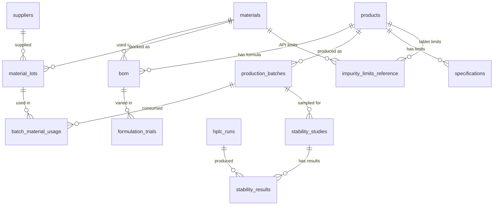

# قاموس البيانات (Data Dictionary)

هاد الملف بيشرح **كل جدول وكل عمود** بقاعدة البيانات `data/pharmapilot.db` (ونفس الشي بملفات `data/csv/`).

- **تاريخ "اليوم" بالبيانات كلها:** `2026-11-25`. كل كلمة "منتهي" أو "قريب ينتهي" محسوبة على هالتاريخ.
- **كل البيانات مصطنعة (synthetic)**، ما في ولا سجل حقيقي من أي شركة، وما في أي بيانات شخصية.
- **التواريخ** كلها نص بصيغة `YYYY-MM-DD`، فبتنقارن كنص عادي (`'2026-12-10' > '2026-11-25'`).
- **PK** = مفتاح أساسي (Primary Key): العمود اللي بيميّز كل سطر. **FK** = مفتاح أجنبي (Foreign Key): عمود بيأشّر على سطر بجدول ثاني.

---

## 1) `products`: المنتجات (25 سطر)

الأدوية النهائية اللي المصنع بينتجها.

| العمود | النوع | المعنى |
|---|---|---|
| `product_id` | INTEGER, PK | رقم المنتج. **1 = Montelukast 10mg** (المنتج الأساسي بالعرض)، 2 و3 = Montelukast 5mg و4mg قابلة للمضغ. |
| `name` | TEXT | اسم المادة الفعالة (مثلاً `Montelukast`، `Paracetamol`). |
| `strength_mg` | REAL | التركيز بالملغ بالحبة الوحدة. |
| `dosage_form` | TEXT | الشكل الصيدلاني: `film-coated tablet`، `chewable tablet`، `tablet`، `capsule`. |
| `shelf_life_months` | INTEGER | مدة الصلاحية بالأشهر: 36 لمنتجات Montelukast، و24 للباقي. |
| `storage_condition` | TEXT | شرط التخزين (توضيحي): Montelukast "Protect from light" لأنه بيتأثر بالضو. |

**المنتجات الـ25:** Montelukast (10، 5، 4)، Paracetamol 500، Metformin (500، 850)، Amlodipine (5، 10)، Atorvastatin (20، 40)، Omeprazole 20، Ibuprofen (200، 400)، Cetirizine 10، Loratadine 10، Fexofenadine 120، Pantoprazole 40، Esomeprazole 20، Losartan 50، Valsartan 80، Candesartan 8، Bisoprolol 5، Rosuvastatin 10، Famotidine 20، Melatonin 3.

---

## 2) `materials`: المواد (120 سطر)

كل مادة ممكن تدخل بالتصنيع.

| العمود | النوع | المعنى |
|---|---|---|
| `material_id` | INTEGER, PK | رقم المادة. **1 = Montelukast sodium** (المادة الفعالة). |
| `name` | TEXT | اسم المادة. المواد الوهمية مكتوب جنبها `(synthetic)`. |
| `type` | TEXT | النوع: `API` (مادة فعالة، 19)، `excipient` (مادة مساعدة، 42)، `coating` (مواد تغليف الحبة، 31)، `packaging` (تعبئة، 28). |
| `cas_no` | TEXT أو فارغ | رقم CAS (رقم تعريف كيميائي عالمي). حقيقي بس للمواد المعروفة، وفارغ للباقي. |
| `unit` | TEXT | وحدة التخزين: `kg` أو `g`. **انتبهوا:** لازم توحّدوا الوحدات قبل أي جمع أو مقارنة. |
| `reorder_level` | REAL | إذا المخزون نزل تحت هالرقم، لازم نطلب. |
| `min_order_qty` | REAL | أقل كمية ممكن نطلبها من المورد. |
| `std_lead_time_days` | INTEGER | مدة التوريد المعتادة بالأيام (من الطلب للوصول). |

---

## 3) `suppliers`: الموردين (50 سطر)

| العمود | النوع | المعنى |
|---|---|---|
| `supplier_id` | INTEGER, PK | رقم المورد. |
| `name` | TEXT | اسم وهمي مثل `Supplier-001 (synthetic)`. |
| `country` | TEXT | Jordan، India، Germany، أو Türkiye. |
| `kind` | TEXT | `manufacturer` (مصنّع) أو `distributor` (موزّع). 25 من كل نوع. |
| `certificates` | TEXT أو فارغ | شهادات الجودة: `GMP`، `GMP; CEP`، `DMF`، أو فارغ. |
| `avg_lead_time_days` | INTEGER | متوسط مدة التوريد من هالمورد (7 إلى 65 يوم). |
| `on_time_rate` | REAL | نسبة التوصيل بالوقت (0.72 إلى 0.99). |

---

## 4) `bom`: الوصفات (Bill of Materials، 250 سطر)

"وصفة" كل منتج: شو بيدخل بالحبة الوحدة وبأي كمية. كل منتج إله 10 مواد.

| العمود | النوع | المعنى |
|---|---|---|
| `product_id` | INTEGER, FK → products | المنتج. |
| `material_id` | INTEGER, FK → materials | المادة. (المفتاح الأساسي هو الاثنين مع بعض.) |
| `qty_mg_per_unit` | REAL | الكمية بالملغ بالحبة الوحدة. مثال: Montelukast sodium = 10.4 ملغ (بتعادل 10 ملغ Montelukast). |
| `function` | TEXT | وظيفة المادة: `API`، `filler` (مالئة)، `binder` (رابطة)، `disintegrant` (مفككة)، `lubricant` (مزلقة)، `glidant` (منزلقة)، `coating`، `flavor`، `capsule shell`. |
| `nominal_pct` | REAL | نسبة المادة من وزن الحبة (%). |
| `approved_min_pct` / `approved_max_pct` | REAL | **النطاق المعتمد (مصطنع):** المادة الفعالة ثابتة بدون نطاق، والمواد المساعدة ±5% أو ±7.5% أو ±10% من النسبة الاسمية. |

**وصفة Montelukast 10mg (المنتج 1):** Montelukast sodium 10.4، Microcrystalline cellulose 45، Lactose monohydrate 35، Croscarmellose sodium 5، Hydroxypropyl cellulose 4، Magnesium stearate 1، HPMC 3، Titanium dioxide 1، Iron oxides 0.2، Colloidal silicon dioxide 0.7 (ملغ بالحبة).

---

## 5) `material_lots`: دفعات المواد بالمستودع (6,000 سطر)

كل مادة إلها 50 دفعة (lot). هاد الجدول هو قلب "تجهيز الدفعة".

| العمود | النوع | المعنى |
|---|---|---|
| `lot_no` | TEXT, PK | رقم الدفعة مثل `LOT-00001`. |
| `material_id` | INTEGER, FK → materials | المادة. |
| `supplier_id` | INTEGER, FK → suppliers | المورد اللي جابها. |
| `qty` | REAL | الكمية الباقية حالياً. **صفر** للدفعات القديمة اللي انستهلكت. |
| `unit` | TEXT | `kg` أو `g` (نفس وحدة المادة). |
| `received_date` | TEXT | تاريخ الاستلام بالمستودع. |
| `mfg_date` | TEXT | تاريخ تصنيع المادة عند المورد. |
| `expiry_date` | TEXT | تاريخ الانتهاء. |
| `retest_date` | TEXT أو فارغ | تاريخ إعادة الفحص (للمواد الفعالة بس): 90 يوم قبل الانتهاء. |
| `status` | TEXT | `released` (معتمدة للاستخدام، 4,800)، `expired` (منتهية، 960)، `quarantine` (بالحجر بانتظار الفحص، 180)، `rejected` (مرفوضة، 60). |
| `assay_pct` | REAL أو فارغ | نسبة نقاوة المادة الفعالة (98 إلى 102%). فارغ للمواد المساعدة. |
| `warehouse_location` | TEXT | مكانها بالمستودع مثل `WH-3-02` (مستودع 3، رف 02). |

**توزيع الدفعات لكل مادة:** أول 8 دفعات "تاريخية" بكمية صفر، وهي اللي انستخدمت بدفعات الإنتاج القديمة. الـ42 الباقية "حالية" وفيها كميات.

**حالات مقصودة للاختبار (الوكيل لازم يكتشفها):**
- **300 دفعة** بتنتهي خلال 60 يوم من "اليوم".
- **180 دفعة** بالحجر (`quarantine`): ممنوع تدخل بأي خطة إنتاج.
- **60 دفعة** مرفوضة (`rejected`).
- **40 دفعة "خطأ إدخال":** حالتها `released` بس تاريخها منتهي. لازم الوكيل ما يصدق الحالة ويفحص التاريخ بنفسه.

---

## 6) `production_batches`: دفعات الإنتاج (3,000 سطر)

كل منتج إله 120 دفعة إنتاج.

| العمود | النوع | المعنى |
|---|---|---|
| `batch_no` | TEXT, PK | رقم الدفعة مثل `BATCH-00001`. |
| `product_id` | INTEGER, FK → products | المنتج. |
| `batch_size_units` | INTEGER | عدد الحبات: 25,000 أو 50,000 أو 100,000 أو 200,000. |
| `mfg_date` | TEXT | تاريخ الإنتاج (من 2022-11-26 لـ2026-11-29). |
| `expiry_date` | TEXT | تاريخ الانتهاء = تاريخ الإنتاج + مدة صلاحية المنتج. |
| `status` | TEXT | `released` (2,800)، `rejected` (75)، `in_process` (25، إنتاجها اليوم)، `planned` (100، مخططة للأيام الجاية). |

---

## 7) `batch_material_usage`: التتبع (15,000 سطر)

مين دفعة مادة دخلت بمين دفعة إنتاج. بيغطي **1,500 دفعة إنتاج** (أول 60 دفعة لكل منتج)، وكل دفعة إلها 10 أسطر (مادة لكل سطر من الوصفة).

| العمود | النوع | المعنى |
|---|---|---|
| `batch_no` | TEXT, FK → production_batches | دفعة الإنتاج. |
| `lot_no` | TEXT, FK → material_lots | دفعة المادة اللي انستخدمت. |
| `qty_used` | REAL | الكمية المستخدمة = عدد الحبات × ملغ بالحبة، محوّلة لوحدة المادة. |
| `unit` | TEXT | `kg` أو `g`. |

**الفايدة:** لو طلعت مشكلة بدفعة مادة، بنعرف فوراً أي دفعات أدوية تأثرت.

---

## 8) `specifications`: المواصفات (300 سطر)

الحدود المقبولة لكل فحص لكل منتج (12 فحص × 25 منتج).

| العمود | النوع | المعنى |
|---|---|---|
| `product_id` | INTEGER, FK → products | المنتج. |
| `test_name` | TEXT | اسم الفحص (القائمة تحت). |
| `unit` | TEXT | `%`، `AV`، أو `N` (نيوتن). |
| `limit_min` | REAL أو فارغ | الحد الأدنى (فارغ = ما في حد أدنى). |
| `limit_max` | REAL أو فارغ | الحد الأعلى (فارغ = ما في حد أعلى). |
| `source` | TEXT | مصدر الرقم: `BP Montelukast Tablets` (المنتج 1)، أو `Synthetic in-house demo` (مصطنع)، أو حد عام لدساتير الأدوية. |

**الفحوصات الـ12:**

| الفحص | شو بيقيس | حد المنتج 1 (Montelukast 10mg) | باقي المنتجات |
|---|---|---|---|
| `assay` | كمية المادة الفعالة من المكتوب على العلبة | 94.0–105.0% (BP) | 92–108% (مصطنع) |
| `dissolution_20min` | قديش ذاب من الحبة بعد 20 دقيقة | لا يقل عن 80% (BP) | لا يقل عن 80% |
| `content_uniformity_av` | تجانس المحتوى بين الحبات (Acceptance Value) | لا يزيد عن 15 | لا يزيد عن 15 |
| `water` | نسبة الماء | لا تزيد عن 5% (مصطنع) | نفسه |
| `hardness` | صلابة الحبة | 30–150 N (مصطنع) | نفسه |
| `impurity_b` | شائبة B | ≤ 0.3% (BP) | نفس الأرقام |
| `impurity_c` | شائبة C (sulfoxide، بتزيد مع الضو والأكسدة) | ≤ 1.7% (BP) | نفسه |
| `impurity_g` | شائبة G (cis-isomer، بتزيد مع الضو) | ≤ 0.5% (BP) | نفسه |
| `impurity_d_plus_e` | مجموع شائبتي D و E | ≤ 0.15% (BP) | نفسه |
| `impurity_f` | شائبة F | ≤ 0.15% (BP) | نفسه |
| `impurity_other` | أي شائبة ثانية | ≤ 0.2% (BP) | نفسه |
| `total_impurities` | مجموع الشوائب | ≤ 2.7% (BP) | نفسه |

---

## 9) `stability_studies`: دراسات الثبات (400 سطر)

دراسة الثبات = بناخذ عينات من دفعة إنتاج، بنخزنها بظرف معين، وبنفحصها على فترات.

| العمود | النوع | المعنى |
|---|---|---|
| `study_id` | INTEGER, PK | رقم الدراسة. |
| `batch_no` | TEXT, FK → production_batches | الدفعة اللي انسحبت منها العينات. |
| `condition` | TEXT | `30C/65%RH` = طويل الأمد (280 دراسة، وهو شرط الأردن حسب WHO)؛ `40C/75%RH` = مسرّع (120 دراسة، أسخن وأرطب عشان نشوف التغيّر أسرع). |
| `start_date` | TEXT | تاريخ بداية الدراسة (5 أيام بعد إنتاج الدفعة). |
| `timepoints_planned` | TEXT | الأشهر المخططة للفحص: `0,3,6,9,12,18,24,36` لطويل الأمد، و`0,3,6` للمسرّع. |
| `status` | TEXT | `complete` (390، خلصت كل نقاطها) أو `active` (10، لسا في نقاط جاية). |

---

## 10) `stability_results`: نتائج الثبات (31,080 سطر)

أكبر جدول. نتيجة لكل (دراسة × نقطة زمنية × فحص).

| العمود | النوع | المعنى |
|---|---|---|
| `study_id` | INTEGER, FK → stability_studies | الدراسة. |
| `timepoint_month` | INTEGER | الشهر: 0 = البداية (time zero)، ثم 3، 6، ... |
| `pull_date` | TEXT | تاريخ سحب العينة وفحصها. |
| `test_name` | TEXT | واحد من الفحوصات الـ12. |
| `result_value` | REAL | النتيجة. |
| `unit` | TEXT | الوحدة. |
| `analyst_code` | TEXT | رمز المحلل مثل `AN-05`. **رمز بس، بدون أسماء.** |
| `hplc_run_id` | INTEGER أو فارغ, FK → hplc_runs | تشغيلة جهاز HPLC اللي طلعت منها النتيجة. **فارغ لـ7,770 نتيجة** لفحوصات ما بتنعمل على HPLC (`content_uniformity_av`، `water`، `hardness`). |
| `result_status` | TEXT | `pass` (31,056)، `oot` (20)، `oos` (4). |

**كيف انحسبت `result_status`:**
- **`oos`** (Out of Specification): النتيجة برا حدود جدول `specifications`.
- **`oot`** (Out of Trend): **قاعدة تجريبية للعرض:** المحتوى (`assay`) نزل **4 نقاط مئوية أو أكثر** عن نتيجة الشهر 0، وهو لسا ضمن المواصفات. القاعدة الحقيقية بيحددها قسم QC.
- **`pass`**: غير هيك.

**كيف تتغيّر الأرقام مع الوقت (محاكاة واقعية):**
- **المحتوى (assay):** بيبدأ 100–101% وبينزل تقريباً 0.1% كل شهر (أسرع بـ2.5 مرة بالدراسة المسرّعة).
- **الشوائب:** بتزيد مع الوقت. شائبتي **C و G بتزيدوا أسرع بمنتجات Montelukast** لأنها بتتأثر بالضو.
- **الذوبان والصلابة:** بينزلوا شوي مع الوقت. **الماء:** بيزيد شوي.
- **12 دراسة** فيها نزول أسرع (حالات OOT)، و**4 دراسات** فيها نزول قوي بيوصل لـOOS بالشهر 36.

**أحسن مثال للعرض: الدراسة 104** (Melatonin، 30C/65%RH)، المحتوى (assay):

| الشهر | 0 | 3 | 6 | 9 | 12 | 18 | 24 | 36 |
|---|---|---|---|---|---|---|---|---|
| النتيجة % | 100.65 | 99.78 | 98.91 | 98.04 | 97.17 | **95.43** | **93.69** | **90.21** |
| الحالة | pass | pass | pass | pass | pass | **OOT** | **OOT** | **OOS** |

يعني الوكيل كان لازم ينبّه من الشهر 18، أي **قبل 18 شهر** من ما توصل لـOOS.

---

## 11) `hplc_runs`: تشغيلات جهاز HPLC (8,000 سطر)

كل مرة بيشتغل جهاز HPLC، لازم يمر بفحص "صلاحية النظام" (System Suitability Test, SST) قبل ما نثق بنتائجه. الشروط مأخوذة من **قالب طريقة التحليل (MOA)** تبع الشركة.

| العمود | النوع | المعنى |
|---|---|---|
| `hplc_run_id` | INTEGER, PK | رقم التشغيلة. |
| `test_name` | TEXT | `assay`، `dissolution_20min`، أو `related_substances` (فحص الشوائب). |
| `run_date` | TEXT | التاريخ. |
| `instrument_id` | TEXT | الجهاز: `LC-01` لـ`LC-08`. |
| `column` | TEXT | العمود المستخدم: `Inertsil ODS-3 5um 4.6x250` (للمحتوى والذوبان) أو `4.6x150` (للشوائب)، زي ما بقالب MOA. |
| `sst_rsd_pct` | REAL | الانحراف المعياري النسبي لخمس حقن من المعيار. **لازم ≤ 2.0%.** |
| `sst_plates` | INTEGER | عدد الصفائح النظرية (كفاءة العمود). **لازم ≥ 1300**، و**≥ 2000** لفحص الشوائب. |
| `sst_asymmetry` | REAL | لاتماثل القمة. **لازم ≤ 2.** |
| `sst_pass` | INTEGER | 1 = نجحت، 0 = فشلت. محسوبة من الثلاث شروط فوق. |

**التوزيع:** 7,840 تشغيلة ناجحة و**160 فاشلة**. التشغيلات المربوطة بنتائج الثبات كلها ناجحة؛ الـ160 الفاشلة تشغيلات منفصلة (للاختبار). **ملاحظة للمرحلة الثانية:** لازم نعمل ملف اختبار فيه نتائج مربوطة بتشغيلات فاشلة، عشان نتأكد إنه الوكيل بيستبعدها.

---

## 12) `formulation_trials`: تجارب تعديل النسب (1,500 سطر)

سجل تجارب سابقة: غيّرنا نسبة مادة وحدة، وشو صار. 60 تجربة لكل منتج.

| العمود | النوع | المعنى |
|---|---|---|
| `trial_id` | INTEGER, PK | رقم التجربة. |
| `product_id` | INTEGER | المنتج. |
| `date` | TEXT | تاريخ التجربة. |
| `material_id` | INTEGER | المادة اللي تغيّرت (FK مع `product_id` على `bom`). بس مواد `filler` أو `disintegrant` أو `lubricant`. |
| `nominal_pct` | REAL | النسبة الأصلية بالوصفة. |
| `used_pct` | REAL | النسبة اللي انجربت (من 65% لـ135% من الأصلية). |
| `deviation_pct` | REAL | الفرق بالنسبة المئوية: (المستخدم ÷ الأصلي − 1) × 100. |
| `assay` | REAL | نتيجة المحتوى %. |
| `dissolution_20min` | REAL | الذوبان بعد 20 دقيقة %. |
| `total_impurities` | REAL | مجموع الشوائب %. |
| `hardness_n` | REAL | الصلابة (نيوتن). |
| `disintegration_min` | REAL | وقت التفكك بالدقائق. |
| `verdict` | TEXT | `meets_spec` (1,395) أو `fails` (105). |
| `notes` | TEXT | وصف قصير، مثلاً `Synthetic one-factor disintegrant trial`. |

**العلاقات اللي انبنت بالبيانات (منطقية علمياً، بس الأرقام مصطنعة):**
- **مادة مفككة أقل** (disintegrant ↓) ← تفكك أبطأ وذوبان أقل.
- **مادة مزلقة أكثر** (lubricant ↑) ← تفكك أبطأ وذوبان أقل.
- **مادة مالئة أكثر** (filler ↑) ← شوائب أكثر شوي.
- الحكم `fails` لما أي نتيجة طلعت برا المواصفات، أو التفكك أكثر من 15 دقيقة.

---

## 13) `impurity_limits_reference`: حدود الشوائب الرسمية (17 سطر)

| العمود | النوع | المعنى |
|---|---|---|
| `reference_id` | INTEGER, PK | رقم السطر. |
| `material_id` | INTEGER أو فارغ | معبّى لما الحد للمادة الخام (Montelukast sodium). |
| `product_id` | INTEGER أو فارغ | معبّى لما الحد للمنتج النهائي (Montelukast 10mg). واحد بس من الاثنين بيكون معبّى. |
| `impurity` | TEXT | اسم الشائبة. |
| `limit_pct` | REAL | الحد الأعلى %. |
| `source` | TEXT | المرجع: `Ph. Eur. 2583` للمادة الخام، أو `BP Montelukast Tablets` للأقراص. |
| `relative_retention` | TEXT | زمن الاحتباس النسبي بجهاز HPLC (بيساعد نعرف الشائبة من مكان قمتها). |

**حدود المادة الخام (Ph. Eur. 2583):** A ≤ 0.2، B ≤ 0.3، C ≤ 0.2، D+E ≤ 0.15، F ≤ 0.15، G ≤ 0.15، أي شائبة ثانية ≤ 0.10، المجموع ≤ 0.6 (%).
**حدود الأقراص (BP):** B ≤ 0.3، C ≤ 1.7، G ≤ 0.5، D و E كل وحدة ≤ 0.15، D+E ≤ 0.15، F ≤ 0.15، أي شائبة ثانية ≤ 0.2، المجموع ≤ 2.7 (%).

---

## العلاقات بين الجداول

